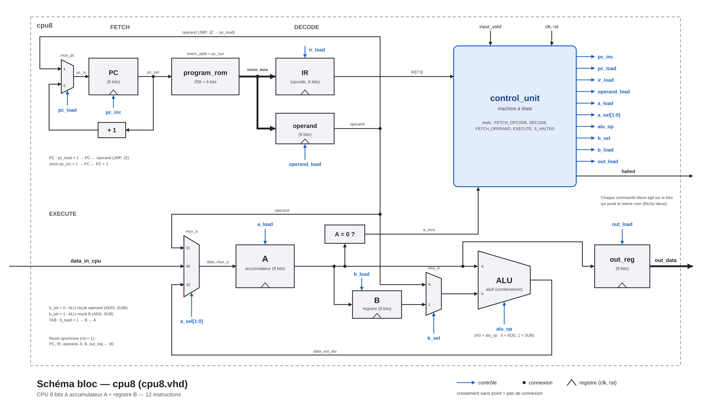

# 8-bit CPU in VHDL

A programmable 8-bit accumulator CPU written from scratch in VHDL and simulated with ModelSim.
I also developped a python script that transforms assembly code to ROM.

## Architecture

- 8-bit data and address bus (256 bytes of program ROM)
- Registers: A (accumulator) and B
- ALU with add and subtract
- Control unit as a state machine: fetch opcode, decode, fetch operand, execute
- Program ROM

## Instruction set

| Opcode | Mnemonic | Description |
|--------|----------|-------------|
| 00 | NOP | Do nothing |
| 10 | LDI v | A <= v |
| 11 | ADDI v | A <= A + v |
| 12 | SUBI v | A <= A - v |
| 13 | ADD | A <= A + B |
| 14 | SUB | A <= A - B |
| 20 | JMP addr | Jump to addr |
| 21 | JZ addr | Jump to addr if A = 0 |
| 30 | OUT | Output A |
| 31 | IN | Load A from the input |
| 32 | TAB | B <= A |
| FF | HLT | Halt the CPU |

## How to run a test

1. Choose the program to run, either:
   - pick one of the built-in programs in `program_rom.vhd` (`constant program_bytes : rom := ...`), or
   - write your own program in assembly and use the Python script in `Python_asm_to_rom/` to turn it into a ROM file.
2. Compile the files from `main_files(ALU,CU,ROM,CPU)/` (including the ROM file) and the testbench you want from `testbench/` in ModelSim.
3. Simulate the matching testbench, e.g. `test_countdown_cpu8`, and run.
4. Look at `out_data` in the waveform.
